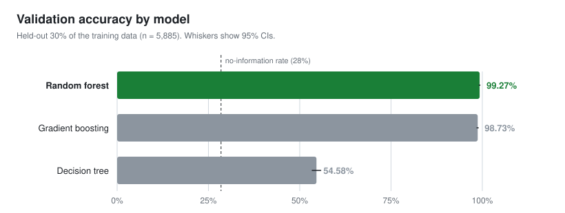
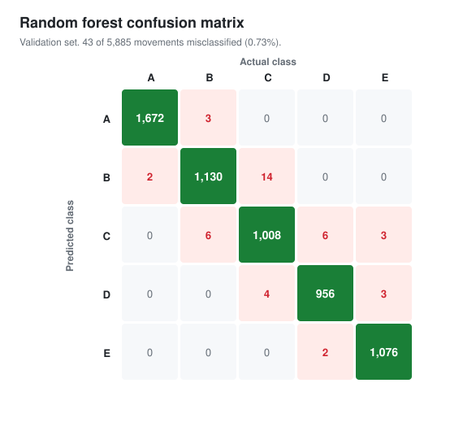

# Predicting Exercise Quality from Wearable Sensors


**Can accelerometer data tell whether someone is lifting a dumbbell correctly, and if not, which mistake they're making?**

This is a multi-class classification project from the Johns Hopkins *Practical Machine Learning* course on Coursera. It compares a decision tree, gradient boosting and a random forest for classifying barbell-lift technique from body-worn sensor data. The random forest reaches **99.3% accuracy** on held-out data.

<p align="center">
  
</p>

## Key results

| Model | Validation accuracy | 95% CI | Cohen's κ | Out-of-sample error |
|---|---:|---|---:|---:|
| **Random forest** | **99.27%** | 99.02–99.47% | 0.991 | **0.73%** |
| Gradient boosting (GBM) | 98.73% | 98.41–99.00% | 0.984 | 1.27% |
| Decision tree (CART) | 54.58% | 53.30–55.86% | 0.408 | 45.42% |

- **Ensembles win by a wide margin.** A single tree barely beats guessing on the four incorrect techniques: sensitivity is 31–46% for classes B–E. Bagging (random forest) and boosting (GBM) both exceed 98%.
- **The random forest misclassifies only 43 of 5,885 validation lifts.** Most errors are B↔C confusions, which are similar arm movements.
- **The test-set predictions** for the 20 unlabeled cases were `B A B A A E D B A A B C B A E E A B B B`.

<p align="center">
  
</p>

## Data

The Weight Lifting Exercises dataset (Velloso et al., 2013). Six participants did sets of 10 unilateral dumbbell biceps curls while wearing sensors on the **belt, forearm, arm and dumbbell**. Each curl was done in one of five ways:

| Class | Execution |
|---|---|
| **A** | Correctly, to specification |
| B | Throwing the elbows to the front |
| C | Lifting the dumbbell only halfway |
| D | Lowering the dumbbell only halfway |
| E | Throwing the hips to the front |

- **Training data:** 19,622 observations × 160 columns.
- **Test data:** 20 unlabeled observations.

The R Markdown file downloads both automatically.

## Methods

1. **Feature cleaning (160 → 53 columns):**
   - Drop columns that are more than 90% missing. These are window-level summary statistics.
   - Drop the 7 identifier and timestamp columns, which would leak recording identity.
   - Drop near-zero-variance predictors.
2. **Validation design:** a stratified 70/30 split into training (13,737) and validation (5,885) sets. Within training, **3-fold cross-validation** tunes each model's hyperparameters (`tuneLength = 5`).
3. **Models** (via `caret::train`):
   - `rpart`: a single classification tree, as an interpretable baseline.
   - `rf`: a random forest.
   - `gbm`: stochastic gradient boosting.
4. **Model selection:** compare accuracy and κ on the untouched validation set. The out-of-sample error is estimated as 1 − validation accuracy.

## Repository structure

```
.
├── analysis/
│   └── activity_prediction.Rmd          # Full analysis (R Markdown)
├── report/
│   ├── activity_prediction_report.pdf   # Rendered report (original 2022 run)
│   └── activity_prediction_report.html
├── figures/                             # README figures (SVG)
└── scripts/
    └── make_figures.py                  # Regenerates figures (Python stdlib only)
```

## Reproducing

Open `analysis/activity_prediction.Rmd` in RStudio and click **Knit**. It downloads the data into `analysis/data/` on first run. Required packages: `caret`, `randomForest`, `gbm`, `rpart`, `rattle`, `corrplot`.

Results may differ slightly from the report because of package versions, even though the seed is fixed (`set.seed(4234)`).

## Skills demonstrated

`Multi-class classification` · `Random forests` · `Gradient boosting` · `Decision trees` · `Cross-validation` · `Hold-out validation` · `Feature cleaning and leakage prevention` · `Confusion-matrix analysis` · `R (caret)`

## Reference

Velloso, E., Bulling, A., Gellersen, H., Ugulino, W., & Fuks, H. (2013). *Qualitative Activity Recognition of Weight Lifting Exercises.* Proceedings of the 4th Augmented Human International Conference.
